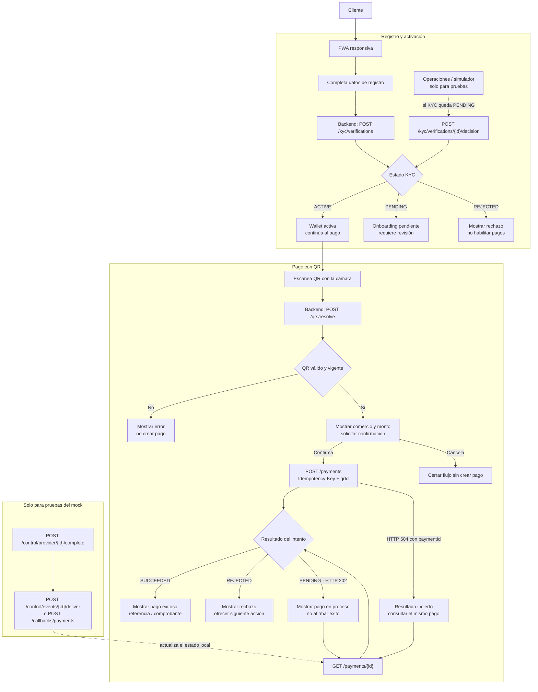

# Onboarding y pago con QR

Diagrama funcional del MVP: registro y activación de wallet, seguido del pago a un comercio mediante QR.

## Comportamiento funcional

- Si el KYC queda `PENDING`, la wallet no se activa hasta que se resuelva.
- Si el QR es inválido o venció, se muestra un error y no se crea el pago.
- El pago se envía solo después de mostrar el comercio y el monto y recibir la confirmación del cliente.
- Si el pago queda `PENDING` o la respuesta es `504`, se consulta el mismo pago. No se crea otro intento automáticamente.
- Para reintentar la misma solicitud, se reutilizan la misma `Idempotency-Key` y el mismo contenido. Un nuevo intento explícito debe tener una clave nueva.
- Los endpoints de control del mock son exclusivamente para pruebas; no se exponen al cliente.